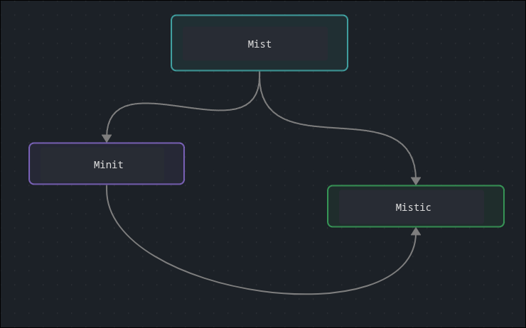
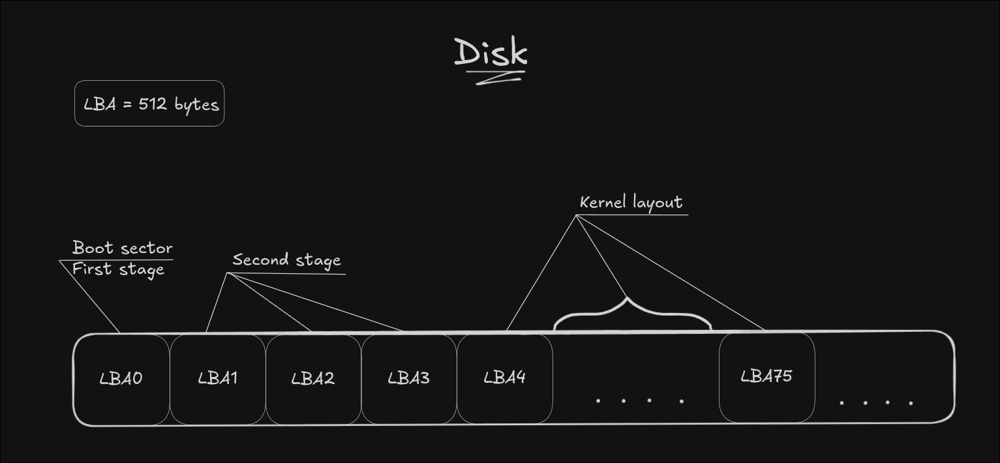

# Architecture
Currently, MistWorks has **3** components. They depend on each other to varying degrees

### Dependency scheme


- Mist -> Minit; Mistic
- Minit -> Mistic
- Mistic -> (none)

All projects use Make to build. Each Makefile expects its dependencies in the `../` directory. At this point, project structure must be:
```
MistWorks/ 
├─ Mist/
├─ Minit/
└─ Mistic/
```

Mist's Makefile invokes `../Mistic` and `../Minit` to get binary files (Example code):
```Makefile
$(MINIT)/build/Minit.img: FORCE
	$(MAKE) -C ../Minit

$(MISTIC)/build/mistic.a: FORCE
	$(MAKE) -C ../Mistic
```

Minit does the same to Mistic:
```Makefile
$(MISTIC)/build/mistic.a: FORCE
	$(MAKE) -C $(MISTIC)
```

## Component boundaries
### Mistic (freestanding):
- Auxiliary functions
- Functions that not dependent by hardware
- Functions, that will be used outside current project in the ecosystem

### Minit:
- All features that relates to boot process
- Features that processes before kernel starting

### Mist:
- All drivers (except disk driver, needed to Minit)
- All hardware interaction after booting
- All features that relates to user
- Kernel features

## Boot flow
Primary disk layout looks like:


When PC starts, BIOS gives control to code from LBA0 (If there is `0x55AA` signature in last 2 bytes on LBA0). After this:
1. Boot process starts in `0x7C00`. Minit's first stage sets up primary environment (page tables (Huge pages), GDT)
2. First stage is copying second stage and kernel to memory. Kernel appears in bounce buffer (`0x10000`) and second stage takes control
3. Second stage is parsing ELF64 kernel headers, moving kernel to needed virtual memory and giving control to it


## Boot protocol
Now Minit doesn't follow any boot protocol, so kernel doesn't get any boot info. It'll be fixed in future updates. See details in [Minit docs](https://github.com/MistWorks/Minit)

Currently, after Minit finished its works, system is in this state:
- Valid GDT address in GDTR (by 1st stage)
- A20 line turned on (by 1st stage)
- Second stage worked from `0x8000` (loaded by 1st stage)
- Page tables are in `0x1000` (PML4), `0x2000` (PDPT) and `0x3000` (PD) (by 1st stage)
- Kernel was in `0x10000` (by 1st stage) and moved to ELF64 entry virtual address (by 2nd stage)

## Mistic contract
While Mist works in ring 0 and don't work in ring 3, Mistic don't follow any agreement as a libc, `sys/` folder are empty, so currently it just gives to Mist and Minit the standard function kit. For details see [Mistic docs](https://github.com/MistWorks/Mistic/docs)

For now, all projects have to use `types.h` from Mistic

## Target platform
MistWorks projects target x86_64 processor. ARM64, RISC-V and others won't be supported in near future

Also they target BIOS systems, so to test them on UEFI system, you have to enable CSM mode. But unlike other processor architectures, UEFI may be supported in the future, after MVP goals reached

## Contacts
About Mist's architecture you can see in [Mist docs](https://github.com/MistWorks/Mist/docs). If you have questions, you can ask me in:
- [Issues](https://github.com/MistWorks/Mist/issues) for Mist
- [Issues](https://github.com/MistWorks/Minit/issues) for Minit
- [Issues](https://github.com/MistWorks/Mistic/issues) for Mistic
- [Issues](https://github.com/MistWorks/Docs/issues) for the ecosystem
- [Email](mailto:imdevyz@gmail.com)
- [Telegram channel](https://t.me/DevyzLog) and [DM](https://t.me/ImDevyz)
- Discord: `imdevyz`